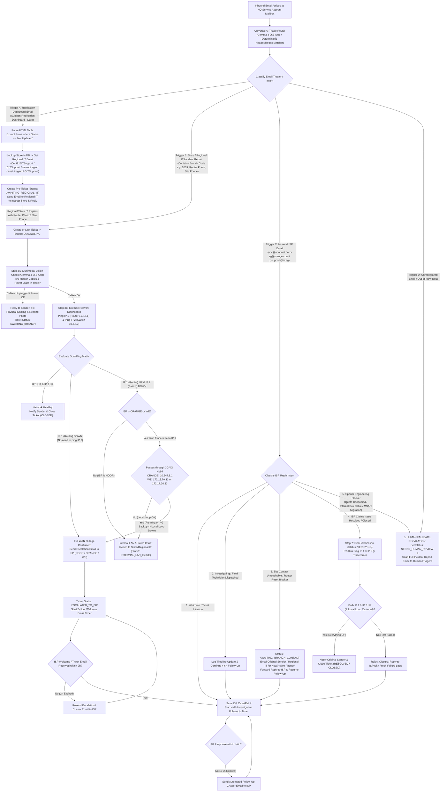
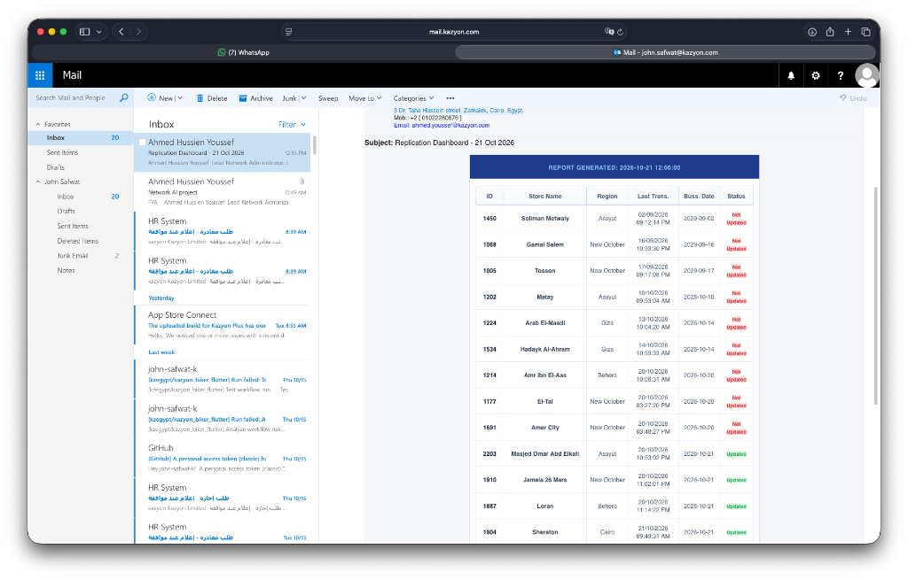
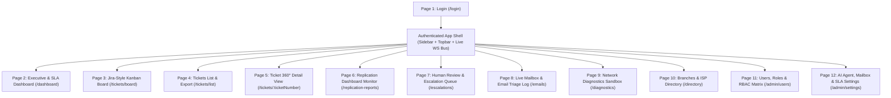
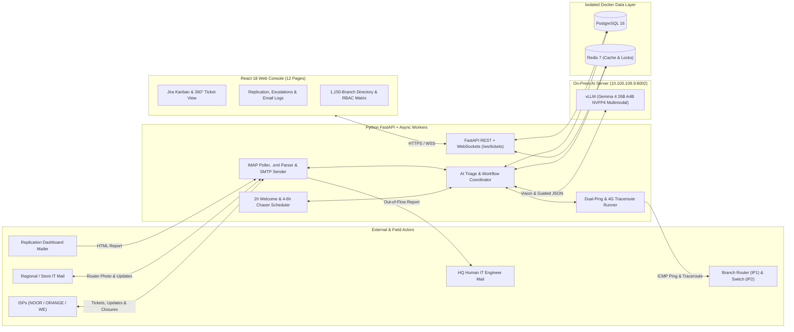
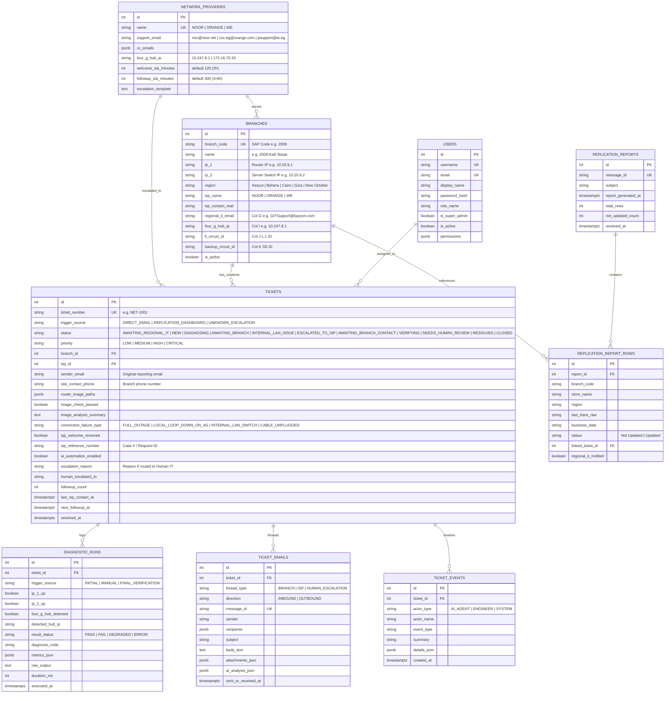

# Master Business Requirements Document (BRD): IT Network Support AI Agent & Ticketing Harness

**Document Version:** 5.0 (Unified Master Specification — Consolidating v1.0 through v4.0 + Phased Implementation Roadmap)  
**Date:** October 21, 2026  
**Tech Stack:** Python 3.12+ (FastAPI + Async/Celery Workers), Self-Hosted Multimodal LLM (`Gemma 4 26B A4B NVFP4` on `vLLM` at `10.100.109.9:8002`), React 18 (TypeScript + Tailwind CSS), PostgreSQL 16, Redis 7  
**Deployment Target:** Dual Isolated Environments (`DEV` and `PROD`) on `10.100.109.9`  

---

## 1. Executive Summary & Project Vision

### 1.1 Business Problem
Kazyon operates **1,150+ branches/stores** across Egypt connected via multiple Network Service Providers (**NOOR**, **ORANGE**, and **WE / Telecom Egypt**). When a branch experiences a network issue or stops syncing transactions:
- **In-Store / Regional IT Support** performs first-line checks on the branch router and emails **HQ IT Infrastructure** with a photo of the router, the Branch SAP Code (e.g., `2009`), and the Site Contact phone number.
- Alternatively, an automated **Replication Dashboard** email alerts HQ IT that certain stores have `Status = Not Updated`, requiring HQ IT to contact **Regional IT** first to inspect the store.
- Previously, HQ IT engineers had to manually inspect router photos, look up branch IPs and ISP circuit IDs from an Excel sheet, run `ping` and `traceroute` tests, format escalation emails to **NOOR**, **ORANGE**, or **WE**, track whether the ISP sent a ticket-opening ("Welcome") email within 2 hours, chase the ISP every 4–6 hours, mediate unreachable branch phone numbers, and re-test connectivity before closing the incident.

### 1.2 Solution Overview
The **IT Network Support AI Agent & Ticketing Harness** is an autonomous, event-driven network operations platform and Jira-style ticketing web application. It continuously monitors the HQ IT Service Account mailbox and automates the entire incident lifecycle while providing full visibility, audit logs, and manual override controls in a Role-Based Access Control (RBAC) web console.

---

## 2. Stakeholders & User Personas

| Persona / Actor | Type | Description & Responsibilities |
| :--- | :--- | :--- |
| **Super Admin** | Internal User | Full system access. Creates/manages users, roles, granular permissions (`resource:action`), mailbox credentials, fallback escalation contacts, and initial Excel seeding. |
| **HQ Network Engineer / IT Support** | Internal User | Monitors the Jira-style Kanban board, inspects ticket timelines/test results/emails, handles `NEEDS_HUMAN_REVIEW` escalations, manually triggers diagnostics, or pauses AI on specific tickets. |
| **Viewer / Auditor / IT Manager** | Internal User | Read-only access to Executive SLA dashboards, regional outage metrics, ISP MTTR performance, and historical ticket logs. |
| **AI Support Agent (`Gemma 4 26B A4B`)** | System Actor | Autonomous multimodal worker running via `vLLM` (`10.100.109.9:8002`). Triages every incoming email, inspects router photos, triggers `ping`/`traceroute` scripts, emails Regional IT & ISPs, chases SLAs, and escalates unknown cases to human engineers. |
| **Regional IT / Store IT Support** | Internal Field Actor | Interacts via email (`BITSupport@kazyon.com`, `CITSupport@kazyon.com`, `newoctregion@kazyon.com`, `assiutregion@kazyon.com`, `GITSupport@kazyon.com`). Troubleshoots in-store routers, sends router photos + site contact numbers, and resolves internal LAN/switch or contact blockers. |
| **Network Providers (ISPs)** | External Actor | **NOOR** (`noc@noor.net`), **ORANGE** (`ccc-eg@orange.com`), and **WE** (`psupport@te.eg`). Receive outage escalations, send Ticket Initiation ("Welcome") emails, dispatch technicians, report blockers, and send Ticket Closure notifications. |

---

## 3. Production Data & Real-World Artifacts Specification (From `Info/`)

### 3.1 Master Branch & ISP Directory (`Copy of All store ISP (2).xlsx`)
The system seeds its initial directory from `Copy of All store ISP (2).xlsx` (**1,150 stores** across 5 regions and 3 ISPs) and allows full CRUD and future re-imports from the Web UI:

| Excel Column | Column Header | Example Value | Database Field & System Usage |
| :--- | :--- | :--- | :--- |
| **Col A** | `SAP Code` | `1173`, `1254`, `2009` | `branch_code` (Unique 4-digit store identifier) |
| **Col B** | `Store Name` | `1173-Ghmrawy`, `2009-Kafr Nasar` | `name` (Store display name) |
| **Col C** | `IP Router` | `10.11.73.1`, `10.20.9.1` | `ip_1` (**Router Gateway IP** — convention: `10.<AB>.<CD>.1`) |
| **Col D** | `server` | `10.11.73.2`, `10.20.9.2` | `ip_2` (**Server Switch IP** — convention: `10.<AB>.<CD>.2`) |
| **Col E** | `Region` | `Behera` (350), `Cairo` (223), `New October` (212), `Assyut` (209), `Giza` (156) | `region` (Geographical region) |
| **Col F** | `E-Mail` | `NOC <noc@noor.net>` `Egypt ccc <ccc-eg@orange.com>` `psupport <psupport@te.eg>` | `isp_contact_mail` (Target email for ISP ticket escalation) |
| **Col G** | *(Regional IT Mail)* | `BITSupport@kazyon.com` (Behera) `CITSupport@kazyon.com` (Cairo) `newoctregion@kazyon.com` (New Oct) `assiutregion@kazyon.com` (Assyut) `GITSupport@kazyon.com` (Giza) | `regional_it_email` (**Regional IT Support Email** — contacted when a store is `Not Updated` in the Replication Dashboard or when a site blocker occurs) |
| **Col H** | `ISP` | `NOOR` (906 stores) `Orang` / `ORANGE` (181 stores) `WE` (63 stores) | `isp_name` (Assigned Network Service Provider) |
| **Col I** | `3G` | `10.247.8.1` (Orange) `172.16.70.33` / `172.17.20.33` (WE) *(Empty for NOOR)* | `four_g_hub_ip` (**3G/4G Backup Hub IP** checked during `traceroute`) |
| **Col J** | `L.L ID` | `QUO1-10316406` (Orange) `6175613` (WE) | `ll_circuit_id` (**Local Loop Order / Circuit ID**) |
| **Col K** | `3G ID` | `QUO1-10316407` (Orange) `6181290` (WE) | `backup_circuit_id` (**3G/4G Backup Order / Circuit ID**) |

---

### 3.2 Real ISP Escalation Formats & Response Patterns (From the 65 `.eml` Files)

| ISP | Support Email & CC | Outbound Escalation Format (Sent by Agent) | Inbound ISP Ticket Ref Pattern | Observed Inbound ISP Scenarios |
| :--- | :--- | :--- | :--- | :--- |
| **NOOR** | To: `noc@noor.net` CC: `ITInfrastructure@kazyon.com` | **Subject:** `store <SAP_CODE>` **Body:** `Dear NOC` `Kindly check connection store <SAP_CODE>` `site contact : <PHONE>` | `Case No: 244010`, `Case# 243860`, `trouble ticket #243881` | • **Auto-Ack:** *"investigated by NOC Engineer, expect update within 2 hours"* • **Ticket Initiation:** *"opened trouble ticket #244010... LL link is down physically"* • **Site Blocker:** *"tried to call site at [010...], unavailable/busy. Kindly provide available site contact"* • **Survey/Update:** *"will dispatch technician to perform site survey"* • **Closure:** *"link has been restored... `NOOR#p v kazyon ... Success rate is 100 percent`"* |
| **ORANGE** | To: `ccc-eg@orange.com` CC: `ITInfrastructure@kazyon.com` | **Subject:** `store <SAP_CODE> # <LL_ID>` **Body:** `Dear NOC` `kindly check L.L and 4G connection store <SAP_CODE>` `<SAP_CODE>` `<LL_ID>` `<3G_ID>` `site contact : <PHONE>` | `ticket number (1-1312322942540 For QID QUO1-10316780 # 1211)` | • **Global/POP Outage:** *"global outage at our POP MRT, checking with core team"* • **Closure:** *"Line restored and stable now... `ping routing-instance Kazyon ... 0% packet loss`"* |
| **WE** | To: `psupport@te.eg` CC: `ITInfrastructure@kazyon.com` | **Subject:** `Kazyon #E33209 #<LL_ID> #<3G_ID> #<SAP_CODE>` **Body:** `Dear support` `kindly check LL & 4G connection` `LL order number : <LL_ID>` `4G order number : <3G_ID>` `site contact <PHONE>` `site work from 9 AM to 12 AM` `power working fine at site` | `[Request ID :##RE-8407532##]` & `ref.tt#8407532` | • **Ticket Opened:** *"We are checking now... Ticket: 8400809"* • **Device Failure:** *"network failure in our devices, team is working on the problem"* • **Branch Action Blocker:** *"1-restart router, 2-reset sim card, 3-try sim on mobile"* • **Special Engineering Blockers:** *"Quota is Consumed — refer to Account Manager"*, *"Internal cable issue between box and router"*, *"MSAN migration process"* • **Closure:** *"problem has been solved and connection is up and working fine now."* |

---

## 4. End-to-End Autonomous Workflows & Business Logic

### 4.1 Master Workflow Diagram

---

### 4.2 Detailed Walkthrough of Every Flow Step

#### Flow 0 (Extension Flow): "Replication Dashboard" Report Trigger

- **Trigger:** The service account receives an email with subject `Replication Dashboard - <Date>` containing an HTML table (`ID`, `Store Name`, `Region`, `Last Trans.`, `Buss. Date`, `Status`).
- **Action:**
  1. The system parses the HTML table and selects all rows where **`Status == "Not Updated"`** (e.g., `1450 - Soliman Metwaly`, `1088 - Gamal Salem`, `1005 - Tosson`).
  2. For each `Not Updated` branch, if no open ticket already exists, the system looks up the branch's **Regional IT Email (`Column G`)** in the database (`assiutregion@kazyon.com`, `newoctregion@kazyon.com`, `GITSupport@kazyon.com`, `BITSupport@kazyon.com`, `CITSupport@kazyon.com`).
  3. Creates a ticket in **`AWAITING_REGIONAL_IT`** status and emails the Regional IT team to inspect the branch and send back the router photo and site contact number to initiate the main flow.
  4. *(Note: The main troubleshooting flow does NOT require a Replication Dashboard email first; it starts immediately whenever Store/Regional IT emails HQ about a branch issue).*

#### Step 1 & 2: Store IT Troubleshoots & Emails HQ Service Account
- Store/Regional IT checks the router in the store and emails HQ with:
  - **Branch SAP Code** (e.g., `2009` $\rightarrow$ `IP 1 = 10.20.9.1`, `IP 2 = 10.20.9.2`),
  - **Site Contact Phone Number** (branch representative's phone number),
  - **Photo(s) of the Router**, and
  - **Issue Details**.

#### Step 3A: Router Image Inspection (`Gemma 4 26B A4B` Vision)
- The HQ AI Agent sends the attached router image(s) to the local `vLLM` multimodal endpoint (`http://10.100.109.9:8002/v1`) to verify whether physical cables are plugged in and power/LEDs are active.
- If cables are unplugged or power is off, the agent replies to the sender to fix the physical cabling (`status = AWAITING_BRANCH`).

#### Step 3B: Dual-Ping (`IP 1` & `IP 2`) + `ORANGE` / `WE` Traceroute Protocol
- **`IP 1` (Router `10.x.x.1`) & `IP 2` (Server Switch `10.x.x.2`) Decision Matrix:**
  1. **`IP 1` UP and `IP 2` UP:** Both router and server switch are reachable $\rightarrow$ Close ticket (`CLOSED`) and notify sender.
  2. **`IP 1` DOWN:** The router is completely unreachable (no need to ping `IP 2`) $\rightarrow$ Branch is down from the WAN network $\rightarrow$ **Escalate to ISP (`NOOR`, `ORANGE`, or `WE`)**.
  3. **`IP 1` UP and `IP 2` DOWN:**
     - **For `NOOR` branches:** Internal LAN/Switch issue between router and switch $\rightarrow$ Return to branch/regional IT (`INTERNAL_LAN_ISSUE`).
     - **For `ORANGE` and `WE` branches (4G vs. Local Loop Protocol):**
       - Runs `traceroute` to `IP 1` (`10.x.x.1`) and checks whether traffic routes through the ISP's **3G/4G Hub IP**:
         - **ORANGE 4G Hub:** `10.247.8.1`
         - **WE 4G Hub:** `172.16.70.33` or `172.17.20.33`
       - **If Traceroute hits the 4G Hub:** The branch is running on **4G Backup** because the **Local Loop is down** (`LOCAL_LOOP_DOWN_ON_4G`) $\rightarrow$ **Escalate to ISP (`ORANGE` or `WE`)**.
       - **If Traceroute does NOT hit the 4G Hub:** The Local Loop is healthy; the issue is an internal LAN switch failure (`INTERNAL_LAN_ISSUE`) $\rightarrow$ Return to branch/regional IT.

#### Step 4: ISP Welcome Mail Check (2-Hour SLA)
- Once escalated to the ISP, the agent waits up to **2 hours** for the ISP's Ticket Initiation / Welcome email (which provides the ISP Case/Ticket reference number).
- If the Welcome email does not arrive within **2 hours**, the agent automatically re-sends/chases the ISP every 2 hours until acknowledged.

#### Step 5 & 6: ISP Investigation Loop (4–6 Hours SLA) & Site Blocker Mediation
- After ticket initiation, the ISP responds within **4 to 6 hours** with line training results, confirmation of fix, or technician dispatch. The agent follows up every **4 to 6 hours** until resolved.
- **Site Contact Blocker Mediation:**
  - If the ISP reports a blocker (e.g., *"We tried to call the site contact phone number, unavailable/busy/switched off"*), the agent emails the original ticket sender / Regional IT telling them the ISP cannot reach the branch and asking them to either make the number available or provide a new phone number.
  - Once Regional/Store IT replies, the agent relays the updated phone number to the ISP and resumes the 4–6 hour follow-up loop.

#### Step 7: Final Dual-Ping Verification Upon ISP Resolution
- When the ISP confirms the issue is resolved, the agent performs a **final verification test**:
  - Re-pings `IP 1` and `IP 2` (and verifies via `traceroute` that `ORANGE`/`WE` branches are back on Local Loop).
  - **If `IP 1` and `IP 2` are UP:** Marks ticket `RESOLVED` / `CLOSED` and sends confirmation to the branch/regional IT.
  - **If the test FAILS:** Replies to the ISP with the fresh failure logs asking them to try again and keeps following up.

#### Step 8: Fallback Escalation for Unrecognized Emails or Out-of-Flow Issues
- Because the service account processes every inbound email, if an email represents a **new/unknown process**, **cannot be matched with high confidence**, or contains a **non-standard ISP engineering blocker** (e.g., *Quota Consumed — refer to Account Manager*, *Extend new internal cable between box and router*, *MSAN Migration*), the agent:
  1. Flags the ticket/email as `NEEDS_HUMAN_REVIEW`.
  2. Sends a **Detailed Escalation Report Email** to a designated **Human IT Support Engineer** with all branch metadata, diagnostic logs, and original email contents.

---

## 5. Complete Web UI Sitemap & Page-by-Page Specification (12 Pages)

| Page # | Page Name & Route | Detailed Features & UI Components |
| :--- | :--- | :--- |
| **Page 1** | **Login Page** `/login` | • Username/Email & Password login form. • Environment badge (`DEV :8085` vs `PROD :8084`) & API connectivity indicator. • Loads JWT & user's granular permission list. |
| **Page 2** | **Executive & Live SLA Dashboard** `/dashboard` | • **KPI Cards:** Total Open Tickets, Tickets Needing Human Review, Overdue 2h ISP Welcome Mails, Overdue 4–6h ISP Updates, Today's `Not Updated` Replication Stores. • **Charts:** Outages & MTTR by ISP (`NOOR`, `ORANGE`, `WE`), Outages by Region (`Behera`, `Cairo`, `New October`, `Assyut`, `Giza`), Outages by Failure Type (`Full Outage`, `4G Backup / Local Loop Down`, `Internal Switch`, `Cables`). • **System Health Bar:** Live status of `vLLM (10.100.109.9:8002)`, `IMAP/SMTP Mailbox`, `PostgreSQL`, and `Redis`. |
| **Page 3** | **Jira-Style Kanban Ticketing Board** `/tickets/board` | • **8 Lifecycle Columns:** (1) `Awaiting Regional IT`, (2) `New & Diagnosing`, (3) `Branch / Internal Action`, (4) `Escalated to ISP (2h Welcome SLA)`, (5) `With ISP (4–6h Loop)`, (6) `Verifying Fix`, (7) `Needs Human Review`, (8) `Resolved / Closed`. • **Rich Ticket Cards:** Ticket #, Priority badge, Branch Code & Name (`2009-Kafr Nasar`), Region, ISP badge + ISP Case #, `IP1`/`IP2`/`4G Hub` status pills, live SLA countdown timer, AI Active/Paused indicator. • **Filters & Actions:** Search by branch/ticket/circuit, filter by ISP/Region/Trigger/Status, drag-and-drop status transitions, and **Create Manual Ticket** modal. |
| **Page 4** | **Tickets List & Export View** `/tickets/list` | • Paginated, sortable master table of all active and historical tickets. • Multi-criteria filter bar + **Export to Excel / CSV** button. |
| **Page 5** | **Ticket 360° Detail View** `/tickets/:ticketNumber` | • **Top Action Bar:** Status/Priority selectors, **`Pause AI / Resume AI` toggle**, `Re-Run Diagnostics Now`, `Force ISP Follow-Up Now`, `Contact Regional IT`, `Escalate to Human Engineer`. • **Left Sidebar:** Branch metadata (`SAP Code`, `IP 1`, `IP 2`, `Region`, `Regional IT Mail`), ISP metadata (`ISP`, `L.L ID`, `3G ID`, `4G Hub IP`, editable `ISP Ticket Ref #`, editable `Site Contact Phone`), SLA timer state. • **Tab 1 — Updates Timeline:** Chronological audit log of every state change, AI decision, script run, email event, plus **Add Internal Note**. • **Tab 2 — Test Results & Router Photo Vision:** Router photo viewer + `Gemma 4 26B A4B` Vision verdict (`Cables Plugged`, `LEDs On`, `Override` button) + list of all `DiagnosticRun` executions (`IP 1`, `IP 2`, `Traceroute 4G Hub`) with expandable raw terminal logs. • **Tab 3 — Request / Branch Emails:** Complete email thread with Store / Regional IT + manual reply composer. • **Tab 4 — ISP Escalation & Response Emails:** Complete email thread with `NOOR` / `ORANGE` / `WE` (initial escalation, 2h chasers, Welcome mail, 4–6h updates, closure snaps) + manual ISP reply composer. |
| **Page 6** | **Replication Dashboard Monitor** `/replication-reports` | • History of all ingested `Replication Dashboard - <Date>` emails. • Breakdown table per report showing `ID`, `Store Name`, `Region`, `Last Trans.`, `Buss. Date`, `Status (Not Updated / Updated)`, whether Regional IT was emailed, and link to the generated ticket. • **Manual Upload / Paste Replication Report** button for testing. |
| **Page 7** | **Human Review & Out-of-Flow Escalation Queue** `/escalations` | • Dedicated queue for items marked `NEEDS_HUMAN_REVIEW` where the AI Agent emailed a Human IT Engineer. • Displays Escalation Reason (`UNRECOGNIZED_EMAIL`, `QUOTA_CONSUMED`, `INTERNAL_BOX_CABLE`, `MSAN_MIGRATION`, `MAX_RETRIES`), notified engineer email, and one-click actions to convert to a ticket, reply manually, or resume AI automation. |
| **Page 8** | **Live Mailbox & Email Triage Log** `/emails` | • Complete log of every inbound and outbound email processed by the service account. • Side drawer showing raw headers, body, attachments, and `Gemma 4 26B A4B` structured classification JSON. • **`.eml` File Simulator / Uploader:** Drag-and-drop any `.eml` file (e.g., from `Info/`) to simulate inbound email processing live. |
| **Page 9** | **Network Diagnostics Sandbox** `/diagnostics` | • Ad-hoc diagnostic runner: pick any branch or enter custom IPs to run `Ping IP 1`, `Ping IP 2`, and `Traceroute (4G Hub Check)` live in the browser without creating a ticket. • View/configure script timeouts and 3G/4G Hub IPs. |
| **Page 10** | **Branches & ISP Directory** `/directory/branches` `/directory/isps` | • **Branches Tab:** Searchable table of all 1,150+ stores (`SAP Code`, `Store Name`, `IP 1`, `IP 2`, `Region`, `Regional IT Email`, `ISP`, `ISP Email`, `3G Hub IP`, `L.L ID`, `3G ID`). Includes **Add/Edit Branch Modal** and **Excel Sheet Bulk Seeder/Updater (`Copy of All store ISP (2).xlsx`)** with dry-run preview. • **ISPs Tab:** Configure `NOOR`, `ORANGE`, `WE` support emails, CC lists, 4G Hub IPs, 2h/4–6h SLA timers, and email templates. |
| **Page 11** | **Users, Roles & RBAC Matrix** `/admin/users` `/admin/roles` | • Super Admin user management (create, edit, suspend, reset password). • **Interactive Permission Matrix** allowing the Super Admin to grant/revoke individual permissions (`tickets:*`, `diagnostics:*`, `emails:*`, `replication:*`, `branches:*`, `isps:*`, `users:*`, `settings:*`). |
| **Page 12** | **AI Agent, Mailbox & System Settings** `/admin/settings` | • Configure Service Account IMAP/SMTP settings + test connection. • Configure **Human IT Fallback Escalation Email(s)**. • Configure `vLLM` endpoint (`http://10.100.109.9:8002`), model parameters, and confidence thresholds. • Configure global 2h / 4–6h SLA timers, email loop guard limits, and Global AI Master Kill-Switch. |

---

## 6. Functional Requirements Catalog (FR-1 to FR-8)

### 6.1 Module 1: Branch & ISP Directory (`app/directory/`)
* **FR-1.1 Excel Seeding:** Parse `Copy of All store ISP (2).xlsx` (`Columns A–K`) and idempotently upsert all 1,150+ branches and 3 ISPs (`NOOR`, `ORANGE`, `WE`).
* **FR-1.2 IP Auto-Derivation & Override:** Support automatic derivation of `IP 1` (`10.<AB>.<CD>.1`) and `IP 2` (`10.<AB>.<CD>.2`) from a 4-digit `SAP Code` while honoring explicit IP overrides stored in the database.
* **FR-1.3 Full UI CRUD:** Allow permitted users to create, edit, filter, export, and bulk-update branches and ISPs from Page 10.

### 6.2 Module 2: Universal Email Ingestion & Dispatch Engine (`app/email_engine/`)
* **FR-2.1 Service Account Polling & `.eml` Injection:** Poll the dedicated HQ mailbox via IMAP (and support `.eml` upload via UI/API for testing) with strict `Message-ID` deduplication.
* **FR-2.2 Dual Thread Correlation:** Maintain separate, non-leaking email threads per ticket for **Branch / Regional IT Communication** (`BRANCH` thread) and **ISP Communication** (`ISP` thread).
* **FR-2.3 Anti-Email-Storm Loop Guard:** Enforce a Redis-backed rate limit per ticket (`MAX_OUTBOUND_EMAILS_PER_TICKET_HOUR`) and ignore auto-vacation/auto-submitted headers where appropriate.

### 6.3 Module 3: Replication Dashboard Report Parser (`app/email_engine/` & `app/agent/`)
* **FR-3.1 HTML Table Extraction:** Detect `Replication Dashboard` emails and parse all store rows (`ID`, `Store Name`, `Region`, `Last Trans.`, `Buss. Date`, `Status`).
* **FR-3.2 Regional IT Notification:** For every store with `Status == "Not Updated"` that does not already have an active ticket, create a ticket (`AWAITING_REGIONAL_IT`) and email the branch's mapped `regional_it_email` (`Column G`).

### 6.4 Module 4: Multimodal Router Photo Vision (`app/agent/`)
* **FR-4.1 Router Image Check:** Pass attached router photos from Store/Regional IT emails to `Gemma 4 26B A4B` on `vLLM` (`10.100.109.9:8002`) to verify physical cable seating and power/LED indicators.
* **FR-4.2 Unplugged Cable Short-Circuit:** If cables are visibly disconnected or powered off, reply to the sender requesting physical correction before running ISP escalation.

### 6.5 Module 5: Dual-Ping & 4G Hub Traceroute Harness (`app/diagnostics/`)
* **FR-5.1 Sandboxed Script Runner:** Execute network checks asynchronously using `asyncio.create_subprocess_exec` (never `shell=True`) with strict timeouts (`DIAGNOSTIC_TIMEOUT_SEC`).
* **FR-5.2 Dual-Ping & Traceroute Decision Tree:**
  * Ping `IP 1` (Router) and `IP 2` (Switch).
  * `IP 1` UP + `IP 2` UP $\rightarrow$ Close ticket (`CLOSED`).
  * `IP 1` DOWN (skip `IP 2`) $\rightarrow$ `FULL_OUTAGE` $\rightarrow$ Escalate to ISP.
  * `IP 1` UP + `IP 2` DOWN $\rightarrow$ If ISP is `ORANGE` or `WE`, run `traceroute` to `IP 1`:
    * If route contains `10.247.8.1` (`ORANGE`) or `172.16.70.33` / `172.17.20.33` (`WE`) $\rightarrow$ `LOCAL_LOOP_DOWN_ON_4G` $\rightarrow$ Escalate to ISP.
    * Otherwise $\rightarrow$ `INTERNAL_LAN_SWITCH` $\rightarrow$ Return to Branch/Regional IT (`INTERNAL_LAN_ISSUE`).

### 6.6 Module 6: ISP Escalation, Timers & Blocker Mediation (`app/agent/`)
* **FR-6.1 Provider-Specific Formatting:** Format outbound ISP emails using the exact templates for `NOOR` (`store <Code>`), `ORANGE` (`store <Code> # <LL_ID>`), and `WE` (`Kazyon #E33209 #<LL_ID> #<3G_ID> #<Code>`).
* **FR-6.2 2-Hour Welcome Mail SLA Timer:** If `isp_welcome_received` is still `False` after 2 hours, automatically re-send/chase the ISP.
* **FR-6.3 4–6 Hour Investigation Follow-Up Timer:** Once the ISP opens the ticket, poll/chase the ISP every 4–6 hours until resolved.
* **FR-6.4 Site Contact Blocker Mediation:** When the ISP reports the site contact phone is unreachable, automatically email the original sender / Regional IT for an active/updated phone number, then relay the response back to the ISP.
* **FR-6.5 Final Post-ISP Verification:** When the ISP claims resolution, re-run Dual-Ping + Traceroute. Close the ticket only if both `IP 1` and `IP 2` are UP (and Local Loop is restored); otherwise reply to the ISP with fresh failure logs.

### 6.7 Module 7: Out-of-Flow & Unknown Email Human Escalation (`app/agent/`)
* **FR-7.1 Human Fallback Report Email:** Whenever an inbound email is unrecognized/out-of-flow, or an ISP reports a special blocker (`QUOTA_CONSUMED`, `INTERNAL_CABLE_ISSUE`, `MSAN_MIGRATION`), transition to `NEEDS_HUMAN_REVIEW` and send a full summary report email to the configured Human IT Engineer email address.

### 6.8 Module 8: Authentication & Granular RBAC (`app/auth/`)
* **FR-8.1 JWT & Super Admin Bootstrap:** Seed the initial Super Admin on first boot and enforce `require_permission("<module>:<action>")` across all API endpoints and WebSocket connections.

---

## 7. Technical Architecture & Dual-Environment Deployment (`10.100.109.9`)

### 7.1 High-Level Architecture Diagram

### 7.2 Dual-Environment Isolation on `10.100.109.9` (`DEV` vs `PROD`)
Both environments run side-by-side on `10.100.109.9` with separate containers, volumes, networks, and ports:

| Resource | DEV Environment (`./deploy.sh --env dev`) | PROD Environment (`./deploy.sh --env prod`) |
| :--- | :--- | :--- |
| **Remote Directory** | `~/it-network-support-agent-dev` | `~/it-network-support-agent-prod` |
| **Compose Project** | `it-net-support-dev` | `it-net-support-prod` |
| **App Container & Port** | `it-net-agent-dev` (`:8085`) | `it-net-agent-prod` (`:8084`) |
| **Postgres Container & Port** | `it-net-postgres-dev` (`:5435`) | `it-net-postgres-prod` (`:5434`) |
| **Redis Container & Port** | `it-net-redis-dev` (`:6385`) | `it-net-redis-prod` (`:6384`) |
| **Volumes** | `it-net-pgdata-dev`, `it-net-redisdata-dev` | `it-net-pgdata-prod`, `it-net-redisdata-prod` |
| **Shared AI Engine** | `http://10.100.109.9:8002` (`Gemma 4 26B A4B`) | `http://10.100.109.9:8002` (`Gemma 4 26B A4B`) |

---

## 8. Complete Database Schema (PostgreSQL ER Diagram)

---

## 9. Multi-Phase Implementation Roadmap (Step-by-Step Build Plan)

Because we will implement this system across multiple focused sessions, the work is organized into **6 self-contained phases**:

### Phase 1: Foundation, Database Schema v2 & 1,150-Store Excel Seeder
- [ ] Upgrade SQLAlchemy models & Alembic migration to include all v5.0 fields (`ip_1`, `ip_2`, `regional_it_email`, `four_g_hub_ip`, `ll_circuit_id`, `backup_circuit_id`, `ReplicationReport`, `ReplicationReportRow`, `DiagnosticRun` dual-ping columns, `Ticket` SLA & blocker columns).
- [ ] Build the Excel seeder (`app/directory/seeder.py`) and seed all **1,150 stores** and **3 ISPs (`NOOR`, `ORANGE`, `WE`)** directly from `Info/Copy of All store ISP (2).xlsx`.
- [ ] Build Auth & Granular RBAC endpoints (`/api/v1/auth/*`, `/api/v1/users/*`) + Directory endpoints (`/api/v1/branches/*`, `/api/v1/isps/*`).

### Phase 2: Network Diagnostic Harness (`Ping IP1/IP2` + `ORANGE`/`WE` Traceroute)
- [ ] Build `app/diagnostics/executor.py` & `service.py` implementing the exact Dual-Ping (`IP 1` Router & `IP 2` Switch) + `ORANGE` (`10.247.8.1`) / `WE` (`172.16.70.33` / `172.17.20.33`) 4G Hub Traceroute decision tree.
- [ ] Add simulation/mock support for local/dev testing alongside live ICMP `ping` and `traceroute` on `10.100.109.9`.
- [ ] Expose `/api/v1/diagnostics/*` endpoints for manual and automated runs.

### Phase 3: Multimodal AI Vision & Universal Email Triage Engine (`vLLM` on `10.100.109.9:8002`)
- [ ] Build `app/email_engine/parser.py` to parse `.eml` files, MIME attachments (router photos), HTML tables (`Replication Dashboard`), and correlate threads (`NOOR` Case #, `ORANGE` ticket #, `WE` Request ID `##RE-...##`).
- [ ] Build `app/agent/classifier.py` using `Gemma 4 26B A4B` (`10.100.109.9:8002`) for:
  1. Router photo visual cable/LED inspection,
  2. Inbound email intent classification, and
  3. ISP response & blocker extraction.

### Phase 4: End-to-End Autonomous Workflow, SLA Timers & Human Fallback Escalation
- [ ] Build `app/agent/workflow.py` & `scheduler.py` orchestrating:
  - Flow 0: `Replication Dashboard` (`Not Updated` $\rightarrow$ Regional IT email),
  - Main Flow: Store Email $\rightarrow$ Vision Check $\rightarrow$ Dual-Ping/Traceroute $\rightarrow$ ISP Escalation (`NOOR` / `ORANGE` / `WE` templates),
  - 2-Hour Welcome Mail SLA chaser & 4–6 Hour Investigation follow-up loop,
  - Site Contact Blocker mediation loop (`ISP` $\rightarrow$ `Regional/Store IT` $\rightarrow$ `ISP`),
  - Final Post-ISP Dual-Ping verification,
  - Out-of-Flow / Special Blocker fallback escalation email to Human IT Engineer.

### Phase 5: Jira-Style Ticketing Web UI & 360° Ticket Detail Console (React)
- [ ] Build the authenticated React App Shell, Login Page (Page 1), Executive SLA Dashboard (Page 2), Jira-Style Kanban Board (Page 3), Tickets List (Page 4), and Ticket 360° Detail View with 4 Tabs (Page 5).

### Phase 6: Operational Views, `.eml` Simulator & Admin Console (React)
- [ ] Build Replication Dashboard Monitor (Page 6), Human Escalation Queue (Page 7), Live Mailbox & `.eml` Uploader/Simulator (Page 8), Diagnostics Sandbox (Page 9), 1,150-Branch & ISP Directory UI (Page 10), Users & Permission Matrix UI (Page 11), and System Settings UI (Page 12).
